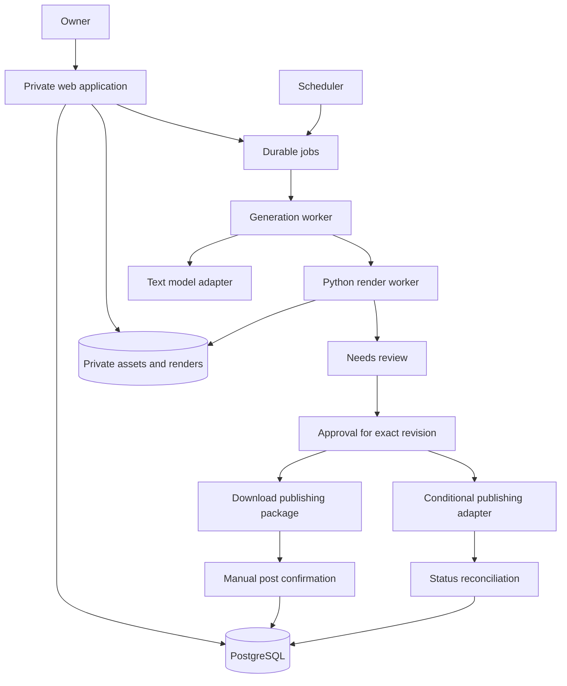

# ReelFarm Personal Clone — Product Requirements Document

## 1. Product decision

Build a private content-production application that turns reusable creative formats into editable TikTok slideshows, prepares a publishing calendar, and requires explicit approval for every post. The primary outcome is a dependable supply of original, relevant content promoting an owned product or business with substantially less daily production work.

The recommended first release includes format creation, image collections, AI writing, deterministic rendering, a review queue, downloadable publishing packages, and manual performance tracking. Recurring jobs produce drafts; they never authorize publication. Integrated publishing is a separately gated extension because TikTok's current application-review rules exclude private/personal applications.[^7]

**ReelFarm can be substantially replicated without training an AI model.** Its publicly documented components include Next.js, Vercel, Supabase, and a Pillow-based renderer. Public frontend code also contains NextAuth, Radix UI, Stripe, and PostHog integrations. The exact AI models, worker hosting, queue technology, and complete backend remain unverified. Section 3 distinguishes direct evidence from inference.

This document specifies functional similarity, not reproduction of ReelFarm's proprietary source code, branding, assets, or private datasets. All requirements after Section 4 are proposed design decisions for this clone unless explicitly labeled as external constraints.

## 2. Scope and assumptions

| Item                 | Decision                                                                                  |
| -------------------- | ----------------------------------------------------------------------------------------- |
| Intended operator    | One owner creating content for their own businesses                                       |
| Approval             | Mandatory per post, including content, account, delivery mode, and time                   |
| Primary format       | Native photo slideshow; optional MP4 export                                               |
| Primary destination  | TikTok; downloadable assets remain reusable elsewhere                                     |
| Initial workload     | Planning assumption: 1–3 brands, 1–5 accounts, 100–300 posts/month                        |
| Language             | English at launch; multilingual layouts subsequently                                      |
| Device               | Desktop authoring; mobile review and individual-image download                            |
| Hosting              | Private authenticated application; an always-on worker if scheduled generation is enabled |
| AI access            | Owner-supplied provider credentials; no subscription resale or credit sales               |
| Initial image source | Owned uploads and explicitly licensed assets                                              |
| Research snapshot    | September 9, 2026, America/Toronto; HTTP inspection occurred September 10 UTC             |

The workload, delivery schedule, and operating budget below are planning assumptions, not measured ReelFarm performance. No paid account or authenticated ReelFarm generation/publishing flow was tested. Findings rely on live public pages, the founder's public walkthrough transcript, official platform documentation, and public deployment artifacts. Consequently, reported features are not all independently exercised.

## 3. ReelFarm product and technology research

### 3.1 Current positioning and pricing

ReelFarm currently emphasizes automated faceless TikTok slideshows. It advertises an editor, recurring generation/publishing, analytics, Pinterest image sourcing, image/video UGC selfies, a slideshow inspiration library, unlimited connected TikTok accounts, and unlimited teammates. The homepage offers three free TikToks.[^1]

| Public plan | Displayed monthly price | Slideshows | Formats |
| ----------- | ----------------------: | ---------: | ------: |
| Growth      |                     $49 |        100 |      10 |
| Scale       |                     $95 |        250 |      20 |
| Enterprise  |                    $195 |        750 |     200 |

The Enterprise description advertises a bring-your-own-key option for unlimited generations. This does not establish unlimited image-generation spend or the exact default model. Currency is displayed as dollars; checkout currency and taxes were not verified.[^1]

At full utilization, the listed price divided by slideshow allowance is approximately $0.49, $0.38, and $0.26 respectively. These are subscription allocation ratios, not production costs. Older search results advertising $19 entry pricing should not drive a present-day build-versus-buy comparison.

### 3.2 What the workflow actually consists of

The founder's walkthrough teaches a format-first workflow: identify a repeatable visual structure, establish image pools, configure the format, supply hooks, and generate variations. It separates hook, body, and optional CTA slides. The demonstration includes image collection uploads/Pinterest selection, multiple text blocks, font size, alignment, width, edge anchoring, content directions, word-length controls, overlays, and adjustable slide count. Templates provide a starting point; settings remain editable after creation.[^4]

The walkthrough's important implication is that a format combines **layout rules and writing instructions**. A clone that only offers “enter a topic, get a video” misses the control that makes recurring production useful. A structured format editor is therefore more central than an open-ended chat interface.

Relevant walkthrough locations: 0:54–2:23 for slide roles; 3:00–4:57 for collections; 5:19–13:21 for formatting; 13:37–16:48 for hooks and generation; 17:54–19:19 for changes to aspect ratio and positioning.[^4]

### 3.3 What the public API reveals

The API exposes asynchronous generation, direct slide construction, status polling, automations, schedules, media records, TikTok publishing, metrics, collections, inspiration search, and Pinterest search. Documented creation supports 1–20 slides, several aspect ratios, text styling, and optional MP4 output. Automation settings include hooks, language, image pools, and publishing configuration. API keys use bearer authentication. Listed limits are 20 requests/minute per user and three concurrent slideshow generations.[^2]

The documentation distinguishes draft delivery from direct publication. It also refers to products and separate slideshow/video records, implying that editable content and rendered output are distinct concepts. Its examples are contracts, not proof of the full database schema or production infrastructure.[^2]

### 3.4 Technology evidence ledger

“Observed” means visible in a public deployment artifact. “Documented” means explicitly stated by ReelFarm. Neither grants access to private source code or proves that every historical component remains active.

| Layer                | Finding                                                    | Confidence and evidence                                                                                      | Implication for the clone                                                                               |
| -------------------- | ---------------------------------------------------------- | ------------------------------------------------------------------------------------------------------------ | ------------------------------------------------------------------------------------------------------- |
| Web framework        | Next.js with React and App Router signals                  | **Observed, high:** `/_next/static/`, `app/layout` and `app/page` bundles, RSC-related response headers.[^5] | A React application with server endpoints is a sensible fit. Exact framework version is unknown.        |
| Web hosting          | Vercel serves the inspected homepage                       | **Observed, high:** `server: Vercel`, `x-vercel-id`, `x-vercel-cache`.[^5]                                   | Does not prove media workers run on Vercel.                                                             |
| Database integration | Supabase                                                   | **Documented, high:** March 13 changelog describes moving Supabase requests from client to server.[^3]       | PostgreSQL is a supported inference because Supabase provides PostgreSQL; exact schema is unknown.[^13] |
| Image renderer       | Pillow-based engine                                        | **Documented, high:** February 27 changelog names Pillow.[^3]                                                | Strong evidence for Python in the image-rendering path; not proof of an all-Python backend.             |
| Authentication       | Google sign-in; NextAuth client code                       | **Observed/documented, high:** public login button, policy, and NextAuth bundle identifiers.[^6][^18]        | Do not assume Supabase Auth powers ReelFarm merely because it uses Supabase.                            |
| UI primitives        | Radix UI                                                   | **Observed, high:** primitive identifiers and Radix CSS variables in bundles.[^19]                           | shadcn/ui is plausible but unconfirmed.                                                                 |
| Styling              | Utility CSS and component styles                           | **Observed, moderate:** utility-class patterns in frontend bundles.[^19]                                     | Tailwind is plausible; exact styling toolchain is unverified.                                           |
| Billing              | Stripe                                                     | **Documented/observed, high:** privacy policy and public Stripe loader.[^6][^20]                             | Omit for a personal application.                                                                        |
| Product telemetry    | PostHog                                                    | **Documented/observed, high:** February 19 changelog and explicit initialization in layout code.[^3][^21]    | Simple operational logs suffice initially.                                                              |
| AI text provider     | Bring-your-own provider key supported in at least one plan | **Advertised, high; default provider/model unknown.**[^1]                                                    | Keep model IDs configurable and provider details explicit.                                              |
| Media delivery       | Dedicated slide domain and CloudFront references           | **Observed, moderate:** `slides.reel.farm` and CloudFront preconnects in HTML.[^5]                           | Suggests external media delivery; does not establish origin topology.                                   |
| Object storage       | AWS S3 suggested                                           | **Weak:** API example uses an S3 URL.[^2]                                                                    | An example is insufficient proof of current production storage.                                         |
| Queue/scheduler      | Recurring jobs and asynchronous processing                 | **Functional inference only.**[^2]                                                                           | No public proof of Celery, Redis, BullMQ, Temporal, or a managed workflow service.                      |
| Video generation     | UGC/greenscreen surfaces exist                             | **Documented feature categories; providers unknown.**[^2]                                                    | No verified attribution to HeyGen, ElevenLabs, fal, Runway, or another vendor.                          |

The source fingerprint is consistent with a conventional application coordinating external AI and media-processing work. It is not evidence of a custom foundation model. There is also no defensible basis for identifying its GPU vendor, model prompts, deployment scale, infrastructure bill, or private service boundaries.

### 3.5 Product maturity signals

The changelog records fixes involving duplicated content, exhausted image pools, paused automations, posting times, and zero-credit handling. It also describes quick-start onboarding and additional language support.[^3] These entries are useful indicators of engineering effort: production reliability depends on state management and recovery, not simply generating attractive slides once.

### 3.6 Conflicts and limits in the public evidence

| Evidence gap or conflict                                                                | Treatment                                                                                                                          |
| --------------------------------------------------------------------------------------- | ---------------------------------------------------------------------------------------------------------------------------------- |
| Homepage uses Enterprise; API references Unlimited/older tier names                     | Use homepage prices for comparison; do not assume an exact tier mapping.                                                           |
| API describes six daily publishes; TikTok documentation describes variable creator caps | Treat six as ReelFarm-specific guidance, not a universal platform constant.[^2][^22]                                               |
| Privacy policy discusses YouTube; current positioning emphasizes TikTok                 | Evidence of historical/integration scope, not confirmation of current YouTube feature parity.[^6]                                  |
| Changelog's newest visible entry is March 14, 2026                                      | Historical implementation evidence, not a complete September release record.                                                       |
| Public bundles include third-party strings                                              | Require actual integration evidence; an error-monitoring hostname inside another SDK is not proof that ReelFarm uses that service. |
| Founder advice and testimonials discuss reach and revenue                               | Do not convert marketing anecdotes into expected outcomes or acceptance criteria.                                                  |
| No authenticated hands-on session                                                       | Editor behavior, latency, AI quality, retries, and actual publication success remain unmeasured.                                   |

## 4. Publishing feasibility

### 4.1 Constraint that changes the architecture

TikTok's app-review guidelines exclude private/personal applications. Its Direct Post guidelines similarly exclude internal account-upload utilities, require an audit for public visibility, and restrict unaudited clients to private posting. Therefore, a private clone should not depend on getting its own public Direct Post access.[^7][^8]

Mandatory approval addresses operator control, but does not itself make a private application eligible for platform approval. Draft upload is also an API capability with access requirements; it is not an automatic workaround.

### 4.2 Supported delivery strategies

| Strategy                                                  | Release decision          | Tradeoff                                                                                                                       |
| --------------------------------------------------------- | ------------------------- | ------------------------------------------------------------------------------------------------------------------------------ |
| Export assets, publish manually in TikTok                 | **Required baseline**     | Works independently of app-review approval; retains a manual final step.                                                       |
| Connect an established publishing API                     | **Conditional extension** | Confirm personal/internal-use eligibility, photo-carousel support, required UX, account limits, and pricing with the provider. |
| Obtain own approved TikTok integration                    | **Future option only**    | Requires an eligible product and approval; cannot promise this for the defined private scope.                                  |
| Use browser automation/cookies to replace publishing APIs | **Outside scope**         | Adds a fragile account/session dependency and is unnecessary for the baseline.                                                 |

Ayrshare is one candidate to evaluate: its official documentation describes TikTok integration and a publishing API accepting media URLs.[^16][^17] This is not a recommendation to purchase it yet. Its exact support for this deployment, photo workflows, commercial disclosures, and economics must pass the integration spike. ReelFarm's own API could support an interim prototype, but would retain the original subscription dependency.

### 4.3 Technical platform boundaries

TikTok's photo API supports up to 35 image URLs, URL-pull delivery, and direct-post or upload modes. The clone deliberately starts with a lower 20-slide authoring limit. Platform upload constraints belong in the delivery adapter, separately from the editable document schema.[^9]

The media guide requires reachable HTTPS media on a verified domain/prefix for URL pulls, without redirects. Photo formats are JPEG/WebP, with a stated 20 MB maximum per image. An internal PNG master must therefore be converted before API delivery. Retain delivery URLs for the complete download window rather than issuing short-lived preview links.[^10]

For direct integration, the composer must use current creator information, require explicit privacy selection, respect allowed interactions, and obtain upload consent. Photo posts must not expose video-only duet/stitch controls. Commercial-content settings and editable caption text belong in the final approval interface.[^8]

Publishing is asynchronous: submission success is not public availability. Store provider identifiers and reconcile status until a terminal result is known.[^11] Standard video-query documentation lists views, likes, comments, and shares; it does not list bookmarks. Photo-post coverage and any additional metric source must be demonstrated before promising automatic analytics parity.[^12]

## 5. Goals, non-goals, and success criteria

### 5.1 Goals

1. Create an approved slideshow without repeatedly writing, formatting, and assembling every slide.
2. Reuse a format across new topics while preserving deliberate visual and writing choices.
3. Generate a manageable queue of drafts in advance.
4. Know exactly which content was approved and where it was delivered.
5. Compare formats using attributable, timestamped results.
6. Bound spending and recover from failed jobs without losing edits or duplicating posts.

### 5.2 Non-goals for the first release

Commercial SaaS onboarding, subscription billing, affiliate programs, agency collaboration, a public viral-content database, automated account creation, engagement automation, and unrestricted external image scraping are excluded. Talking avatars, voice cloning, full text-to-video generation, automatic music licensing, and integrated cross-platform publishing are later projects.

### 5.3 Proposed acceptance targets

| Measure                       | Initial target                                       | Measurement                            |
| ----------------------------- | ---------------------------------------------------- | -------------------------------------- |
| First usable export           | Within 15 minutes after providing a brief and assets | Timed onboarding trial                 |
| Routine review effort         | Median under 3 minutes/post                          | Active review time across 30 posts     |
| Content usability             | At least 80% need only minor copy/layout changes     | Owner rates 50 generated drafts        |
| Generation reliability        | At least 95% ready without manual job recovery       | 100-job representative run             |
| Six-slide render latency      | p95 under 30 seconds, excluding queue wait           | Warm worker, cached assets             |
| Six-slide complete generation | p95 under 120 seconds, excluding backlog             | Fixed model/config, 100-job run        |
| Approval enforcement          | Zero unapproved external deliveries                  | Fault and authorization tests          |
| Duplicate delivery prevention | Zero duplicates in retry/concurrency tests           | Simulated timeouts and repeated events |
| Cost visibility               | Every paid attempt accounted for                     | Usage ledger reconciliation            |

These are release targets, not external benchmarks. Views, reach, and revenue are tracked outcomes rather than software guarantees.

## 6. Core concepts and user journeys

**Brand brief:** Product description, audience, supported claims, tone, destination, and prohibited claims. **Format:** Versioned rules for layout and writing. **Campaign:** A brand, format, topic queue, target account, and draft-generation schedule. **Post:** Editable content with immutable revisions. **Render:** Files produced from one revision. **Approval:** Authorization for an exact revision and delivery instruction. **Delivery:** A distinct attempt to export, upload, or publish approved content.

### Journey A — First slideshow

The owner creates a brand brief, uploads an image collection, selects a starter format, enters a topic, and generates a draft. The editor presents the hook and subsequent slides together. The owner edits text and crops, previews final renders, approves an export package, and downloads ordered images plus caption text. They publish manually and record the resulting URL.

### Journey B — Recurring content

The owner assigns topics and a daily draft schedule to a campaign. The worker produces drafts up to a configurable backlog limit. The review queue groups them by planned date and account. The owner approves specific posts individually. Missed review deadlines remain pending; the application never substitutes another post or publishes an unreviewed draft.

### Journey C — Revise an approved post

Editing text, images, ordering, crop, caption, account, disclosure, or delivery mode creates a new revision and invalidates affected approval. The approved original remains auditable. A render finishing after a newer edit cannot overwrite the latest revision or become publishable by accident.

### Journey D — Recover from failure

A failed render identifies the affected asset or step. Retry resumes the failed step with the same content. If an external publish request times out after submission, the system marks its outcome unknown and checks the provider instead of blindly submitting again. Manual delivery remains available after the ambiguity has been resolved.

## 7. Functional requirements

Priority definitions: **P0** required for the personal MVP; **P1** next release; **P2** optional expansion. Conditional publishing requirements become mandatory before any integration is enabled.

### 7.1 Brand briefs and onboarding

| ID    | Priority | Requirement and acceptance                                                                                                                                               |
| ----- | -------- | ------------------------------------------------------------------------------------------------------------------------------------------------------------------------ |
| BR-01 | P0       | Create/edit multiple briefs with product, audience, benefit, tone, approved facts, prohibited claims, and destination. Generation always records the brief version used. |
| BR-02 | P0       | Provide three original starter formats: educational list, mistakes-and-fixes, and product-use examples. Each produces a valid six-slide sample.                          |
| BR-03 | P0       | Show readiness checks for assets, model credentials, and a successful sample. No TikTok connection is required to start.                                                 |
| BR-04 | P1       | Import public website copy as an editable draft brief. Imported text cannot alter system instructions, credentials, or publishing permissions.                           |

### 7.2 Format builder

| ID    | Priority | Requirement and acceptance                                                                                                               |
| ----- | -------- | ---------------------------------------------------------------------------------------------------------------------------------------- |
| FM-01 | P0       | Define hook/body/CTA roles, 2–20 slides, and optional CTA position. Save a versioned format independent of campaigns.                    |
| FM-02 | P0       | Assign image pools separately by role; permit a fixed owned product image. Empty pools fail before generation.                           |
| FM-03 | P0       | Configure text blocks with instruction, desired length, font, size, color, alignment, width, position, and background/outline treatment. |
| FM-04 | P0       | Support 4:5 and 9:16 canvases. Changing format dimensions does not silently change an approved post.                                     |
| FM-05 | P0       | Preview sample content and validate layout before enabling recurrence. Duplicate a format without affecting its source.                  |
| FM-06 | P1       | Add multi-image grids, square/landscape presets, and mixed layouts after single-image rendering is reliable.                             |

Use canonical pixel dimensions and normalized geometry in the new schema. Do not copy small UI preview font values directly into full-resolution output. Persist font file/version and renderer version for reproducibility.

### 7.3 Asset collections

| ID    | Priority | Requirement and acceptance                                                                                                                    |
| ----- | -------- | --------------------------------------------------------------------------------------------------------------------------------------------- |
| AS-01 | P0       | Upload JPEG, PNG, and WebP; normalize orientation and color; generate thumbnails. Reject invalid, oversized, or decompression-bomb inputs.    |
| AS-02 | P0       | Save source, ownership/license note, tags, dimensions, hash, and allowed use. Unknown-rights assets cannot be selected for approved delivery. |
| AS-03 | P0       | Select backgrounds without duplicates within a post where enough assets exist. Warn when a collection cannot satisfy the requested variation. |
| AS-04 | P0       | Preserve used assets when removing them from a collection. Existing revisions retain their referenced files.                                  |
| AS-05 | P1       | Add a licensed search-provider adapter. Rights information accompanies each imported image.                                                   |
| AS-06 | P2       | Optional Pinterest reference links/search. Finding an image does not establish reuse rights; discovery and ingestion remain distinct.         |

### 7.4 AI writing and quality

| ID    | Priority | Requirement and acceptance                                                                                                                             |
| ----- | -------- | ------------------------------------------------------------------------------------------------------------------------------------------------------ |
| AI-01 | P0       | Generate structured content from brief, topic, format, and recent-history context. Output must pass a strict schema before rendering.                  |
| AI-02 | P0       | Return hook, body text, optional CTA, caption, and any unsupported-claim flags. Never invent product results, testimonials, or personal experiences.   |
| AI-03 | P0       | Regenerate a selected block or slide while preserving locked copy, assets, and layout elsewhere.                                                       |
| AI-04 | P0       | Detect exact duplicate hooks and normalized text. Block accidental duplicate scheduled drafts; allow intentional duplication with a recorded override. |
| AI-05 | P0       | Bound output length and model attempts. Invalid output receives at most two repair attempts; repeated failures become actionable errors.               |
| AI-06 | P0       | Record provider, model, prompt version, input/output usage, attempt costs, and quality flags. Keys never reach the browser bundle.                     |
| AI-07 | P1       | Add semantic similarity checks after enough owned post history exists to evaluate false positives.                                                     |
| AI-08 | P1       | Add multilingual generation only after representative fonts and line-breaking tests pass.                                                              |

A model chooses words and optional asset tags; application code decides permissions, scheduling, costs, and final publication. Keep writing instructions separate from deterministic layout constraints. More creative autonomy is not a substitute for schema validation.

### 7.5 Editing and rendering

| ID    | Priority | Requirement and acceptance                                                                                                                  |
| ----- | -------- | ------------------------------------------------------------------------------------------------------------------------------------------- |
| ED-01 | P0       | Edit copy, reorder slides, replace/crop images, and adjust text. Autosave acknowledges the persisted revision and detects concurrent edits. |
| ED-02 | P0       | Provide undo/redo within a session and recover saved work after reload.                                                                     |
| ED-03 | P0       | Detect clipped text and missing glyphs. Offer shortening or resizing; never silently discard text.                                          |
| ED-04 | P0       | Render approved previews with the same engine used for export. Approval remains disabled while that revision is rendering.                  |
| ED-05 | P0       | Export ordered JPEGs, optional PNG masters, caption text, and a JSON manifest. Individual images are downloadable on mobile.                |
| ED-06 | P1       | Export MP4 with adjustable slide duration and optional owned/licensed audio. Validate duration, dimensions, codec, and frame rate.          |

Default design canvases are 1080×1350 and 1080×1920. Each destination adapter must validate its currently accepted image dimensions and encoding. Keep social-interface safe-area guides visible during authoring without promising that one overlay matches every device or app version.

### 7.6 Review and approval

| ID    | Priority    | Requirement and acceptance                                                                                                     |
| ----- | ----------- | ------------------------------------------------------------------------------------------------------------------------------ |
| AP-01 | P0          | Every generated post enters Needs review. No global “approve all future posts” setting exists.                                 |
| AP-02 | P0          | Approval binds immutable revision, rendered asset hashes, caption, destination/account, mode, and planned delivery time.       |
| AP-03 | P0          | Any material change invalidates approval. An expired or revoked approval cannot create delivery work.                          |
| AP-04 | P0          | Allow Reject, Edit, Approve export, and Archive. Archive does not delete referenced media or audit events.                     |
| AP-05 | Conditional | Distinguish Approve upload to draft from Approve publication. Sending media to a provider requires the matching authorization. |
| AP-06 | Conditional | Worker verifies approval again immediately before external submission. Queue insertion alone is insufficient.                  |

Approval is enforced on the server, not merely by hiding a button. A generated draft and its approved version must never share a mutable publishing pointer.

### 7.7 Calendar and recurring generation

| ID    | Priority | Requirement and acceptance                                                                                                                                           |
| ----- | -------- | -------------------------------------------------------------------------------------------------------------------------------------------------------------------- |
| SC-01 | P0       | Save recurrence using an IANA timezone, default America/Toronto, and show the next five occurrences. Persist actual job times in UTC.                                |
| SC-02 | P0       | Separate draft-generation time from planned posting time. Start with a 24-hour generation lead time.                                                                 |
| SC-03 | P0       | Pause/resume generation, cap backlog at seven unreviewed posts per campaign, and cap spend. Pausing generation does not silently cancel already-approved deliveries. |
| SC-04 | P0       | Provide a separate stop-deliveries control. Explain whether any external submission has already begun.                                                               |
| SC-05 | P0       | Resolve DST explicitly: skip nonexistent local times and choose the first occurrence of repeated local times. Show this policy in schedule help.                     |
| SC-06 | P0       | After downtime, create at most one recovery draft per campaign and mark missed slots. Never generate a burst for every missed occurrence.                            |

### 7.8 Delivery and analytics

| ID    | Priority    | Requirement and acceptance                                                                                                                                                         |
| ----- | ----------- | ---------------------------------------------------------------------------------------------------------------------------------------------------------------------------------- |
| DL-01 | P0          | Manual package includes ordered files, copyable caption, target account label, and disclosure/music notes. Download is not marked Published.                                       |
| DL-02 | P0          | Allow manual confirmation with post URL, account, and publication time; record evidence source as owner-confirmed.                                                                 |
| DL-03 | Conditional | Add provider connection/disconnection and capabilities. Unsupported controls are hidden or explained.                                                                              |
| DL-04 | Conditional | Track submission, processing, published, failed, and unknown separately. Show provider error category and recovery action.                                                         |
| AN-01 | P0          | Manually enter/import timestamped metrics and export CSV. Missing metrics display unavailable, never zero.                                                                         |
| AN-02 | P1          | Automatically refresh supported owned-account metrics. Show source and last-successful-refresh time.                                                                               |
| AN-03 | P1          | Compare by campaign, format version, hook, account, and equal post age. Use medians and sample counts.                                                                             |
| AN-04 | P1          | Track destination visits/conversions where owned-site instrumentation permits. Bio-link traffic is generally account/campaign attribution unless a post-specific mechanism exists. |

## 8. Interface specification

Use a compact sidebar: Overview, Review queue, Campaigns, Formats, Assets, Calendar, Results, Settings. The overview prioritizes pending review, failed jobs, upcoming delivery, and spend. A metrics-heavy executive dashboard is unnecessary for one operator.

The campaign screen contains its brief, chosen format, topic queue, cadence, generated posts, and status. The format screen contains slide-role configuration and a live sample. The editor has a slide list on the left, a large canvas in the middle, and a contextual inspector on the right.

The review screen shows the exact render, caption, destination, scheduled time/timezone, asset provenance, and quality flags. Show separate actions for export, draft upload, and publication. Success messages describe the actual stage reached.

Empty states lead to a concrete next step. Error states preserve work. Color cannot be the only status indicator. Keyboard users must be able to reorder slides, edit all properties, preview, and approve. On mobile, prioritize review and download rather than a compressed desktop editor.

## 9. Proposed architecture

### 9.1 Recommended implementation

Use a TypeScript web application, PostgreSQL, object storage, and a separate Python worker for Pillow rendering. This aligns with the confirmed product shape while keeping long-running work outside ordinary web requests. The following choices are recommendations, not additional discoveries about ReelFarm.

| Component        | Recommendation                                                        | Rationale                                                                                                                  |
| ---------------- | --------------------------------------------------------------------- | -------------------------------------------------------------------------------------------------------------------------- |
| Application      | React/Next.js with TypeScript                                         | Shared editor and server application; framework version chosen and pinned at implementation.                               |
| Database         | PostgreSQL; Supabase is a convenient managed option                   | Relational state, revisions, schedules, and transactions.                                                                  |
| Authentication   | One allowlisted owner using a maintained authentication provider      | Public signup and multi-tenant billing add no value here.                                                                  |
| Storage          | Private object storage with signed application access                 | Preserve assets and exports independently of application deploys.                                                          |
| Rendering        | Python/Pillow worker                                                  | Efficient image composition; explicit text measurement and overlays.[^14]                                                  |
| Optional video   | FFmpeg in the worker container                                        | Encode deterministic slide sequences and audio.[^15]                                                                       |
| Job coordination | PostgreSQL-backed jobs with leases; one scheduler and bounded workers | Avoid adding Redis for the assumed workload. PostgreSQL documents skip-locked row selection for queue-like consumers.[^23] |
| Text generation  | OpenAI Responses API with a configurable model                        | Structured copy generation, with model/cost captured per run.                                                              |
| Monitoring       | Structured logs and database job dashboard                            | Enough to diagnose a personal installation without extensive telemetry.                                                    |

For a TypeScript-only team, a shared HTML slide component rendered by headless Chromium is a credible alternative; Playwright supports element screenshots.[^24] Choose this instead of Pillow if exact CSS preview parity outweighs browser-worker memory and runtime overhead. Do not maintain two independent export engines in the MVP.

### 9.2 Processing diagram



### 9.3 Generation pipeline

1. Resolve an immutable campaign/format/brief snapshot and selected topic.
2. Reserve a bounded job budget and persist a stable generation ID.
3. Request structured copy using supported facts and recent content history.
4. Validate schema, factual flags, lengths, and duplicate checks.
5. Select assets from eligible pools; persist the selection and random seed.
6. Measure text, calculate geometry, and render versioned slide files.
7. Validate image dimensions, completeness, glyph coverage, and overflow.
8. Persist the post revision and render manifest atomically with job completion.
9. Place the post in review; settle recorded costs and release unused budget.

Retrying a render must not regenerate copy or select different assets. Intentionally requesting a new creative variation is a new generation attempt.

## 10. Data model

All identifiers below are proposed UUIDs. Use database-enforced foreign keys and ownership checks. Versioned content is immutable once saved as a revision; mutable working edits use an optimistic revision counter.

| Entity                        | Principal fields                                                                                      |
| ----------------------------- | ----------------------------------------------------------------------------------------------------- |
| owner                         | id, authenticated_subject, timezone, preferences                                                      |
| brand_brief                   | id, owner_id, name, current_version                                                                   |
| brief_version                 | id, brief_id, facts, audience, tone, destination, forbidden_claims                                    |
| asset                         | id, owner_id, object_key, sha256, media_type, width, height, rights_status, provenance                |
| collection / collection_asset | collection identity and ordered asset membership                                                      |
| format / format_version       | name, schema_version, slide_roles, geometry, writing_rules, renderer_version                          |
| campaign                      | brief_id, format_version_id, account_id, timezone, recurrence, paused, backlog_limit                  |
| topic                         | campaign_id, text, order, status, last_used_at                                                        |
| generation                    | campaign_id, topic_id, snapshot, model, prompt_version, seed, status                                  |
| post                          | owner_id, campaign_id, latest_revision_id, archived_at                                                |
| post_revision                 | post_id, revision_number, slide_document, caption, warnings, content_hash                             |
| render                        | revision_id, renderer_version, manifest_key, status, asset_hashes                                     |
| approval                      | revision_id, render_id, delivery_instruction_hash, approved_at, revoked_at, owner_id                  |
| social_account                | provider, external_id, display_name, capabilities, connection_status, secret_reference                |
| delivery                      | approval_id, account_id, due_at, mode, status, idempotency_key, provider_publish_id, external_post_id |
| delivery_attempt              | delivery_id, attempt_number, request_hash, response_category, started_at, completed_at                |
| metric_snapshot               | delivery_id, measured_at, source, views, likes, comments, shares, bookmarks, availability             |
| job                           | type, payload_reference, status, due_at, lease_until, attempts, last_error                            |
| cost_event                    | generation_id, provider_request_id, quantity, unit, unit_price, amount, currency, estimate_or_actual  |
| audit_event                   | owner_id, action, entity_id, revision_id, occurred_at, safe_metadata                                  |

Required unique constraints: one generation per campaign occurrence; one revision number per post; one delivery per approval/account/mode instruction; one provider event ID per received event. Index due jobs and deliveries by status/time. Preserve external IDs as strings, including TikTok identifiers.

For Supabase, enable appropriate row-level security on exposed tables and keep service credentials server-side. Ownership must be checked even in a single-owner application. Administrative server credentials do not remove the need to authorize incoming requests.[^25]

## 11. Internal API contract

These routes are a proposed clone API, not a copy of ReelFarm's route surface. Expose only authenticated owner operations. Long-running requests return HTTP 202 with an explicit job ID and resource ID.

| Route                                          | Purpose                                         |
| ---------------------------------------------- | ----------------------------------------------- |
| `POST /api/brands`                             | Create a brief                                  |
| `POST /api/assets/uploads`                     | Authorize a bounded upload                      |
| `POST /api/formats`                            | Save a format version                           |
| `POST /api/campaigns`                          | Save recurrence and draft settings              |
| `POST /api/generations`                        | Start a draft and return generation/post IDs    |
| `GET /api/jobs/:id`                            | Return progress, stage, and safe errors         |
| `PATCH /api/posts/:id`                         | Save edits with expected revision number        |
| `POST /api/posts/:id/renders`                  | Render a specific revision                      |
| `POST /api/posts/:id/approvals`                | Approve exact revision and delivery instruction |
| `DELETE /api/approvals/:id`                    | Revoke before submission                        |
| `POST /api/deliveries`                         | Create an authorized export/upload/publication  |
| `POST /api/deliveries/:id/manual-confirmation` | Record a manually published URL                 |
| `POST /api/provider-events/:provider`          | Validate and reconcile provider events          |

Use machine-readable errors such as `REVISION_CONFLICT`, `APPROVAL_REQUIRED`, `ASSET_RIGHTS_UNKNOWN`, `BUDGET_EXCEEDED`, `PROVIDER_UNAVAILABLE`, and `DELIVERY_OUTCOME_UNKNOWN`. Creation requests accept idempotency keys. List routes use pagination; errors never expose credentials or raw provider tokens.

## 12. State, concurrency, and recovery

### 12.1 State separation

```text
Generation: queued → writing → validating → rendering → ready | failed | cancelled
Review:     needs_review → approved | rejected
                         approved → revoked (material edit/cancellation)
Delivery:   pending → submitting → processing → published | failed | unknown
Manual:     package_ready → owner_confirmed_published
```

“Ready” means local files exist. “Approved” means the owner authorized specific content and delivery. “Published” requires provider confirmation or an explicitly labeled manual confirmation. These states must not be collapsed into one success flag.

### 12.2 Worker rules

Workers claim due jobs with leases and renew leases while active. Persist each completed stage before advancing. Use bounded retries with exponential backoff and jitter for transient failures; stop for invalid content, revoked access, exhausted budgets, or rejected permission. A watchdog identifies expired leases and stuck jobs.

Use a transactional outbox or equivalent atomic database operation so committing approved work and enqueuing it cannot diverge. A delivery worker rechecks approval and cancellation immediately before submission. Once a provider request may have succeeded, use status reconciliation rather than automatic resubmission. If no provider identifier was received and there is no reliable idempotency/reconciliation mechanism, require owner inspection.

Cancellation before dispatch prevents submission. Cancellation after dispatch is best effort; display the current provider stage and do not promise recall. TikTok documents that media-pull cancellation cannot reliably stop work already near completion.[^10]

### 12.3 Budget rules

Reserve maximum allowed job cost before a paid call. Record actual charges for every attempt, including discarded drafts and repairs. Stop recurrence when the daily/monthly cap would be exceeded. A credentials change or budget increase cannot automatically retry previously ambiguous external publications.

## 13. Security and operational requirements

The application must authenticate every non-public request and allow only the configured owner. Store AI/provider secrets in a secret store or encrypted server configuration. Never log access tokens, refresh tokens, raw authorization headers, or signed URLs.

Remote-image ingestion must validate redirects and resolved IP addresses, block private/local/metadata destinations, enforce byte and pixel limits, and decode images in a restricted worker. Do not allow arbitrary model-provided URLs, shell fragments, HTML, or filesystem paths to reach render commands.

Keep uploaded originals private. If a publishing provider needs internet-readable media, expose only the approved delivery files through a dedicated controlled path for the required duration. Purge temporary delivery objects after a terminal result plus a configurable recovery interval.

Back up the database daily and preserve original assets separately from reproducible renders. Proposed recovery objectives are at most 24 hours of database loss and restoration within four hours. Test a restore before launch. Keep audit/cost history for one year by default, with configurable retention and explicit cleanup.

Pin application, worker, model configuration, fonts, and render dependencies. A dependency update must rerun the rendering fixtures. A model change requires a small quality comparison against the existing prompt suite.

## 14. Cost model and build-versus-buy

### 14.1 Text-generation estimate

The clone uses OpenAI with a configurable model. Availability, pricing, and model identifiers must be checked in the actual provider account at implementation; these choices do not identify ReelFarm's internal model.

For planning, assume 4,000 input and 2,000 output tokens per six-slide post, including formatting instructions but excluding image generation:

```text
Text cost/post = (4,000 × $2 + 2,000 × $10) / 1,000,000 = $0.028
With 25% retry/revision allowance = $0.035/post
100 posts/month = $3.50 text generation
300 posts/month = $10.50 text generation
```

This is an illustrative token budget, not a measured benchmark. Image interpretation, additional critique calls, and reasoning usage can increase it. Meter actual calls before adopting the estimate.

### 14.2 Overall operating budget

| Category                               |           Planning allocation, USD/month | Qualification                                                          |
| -------------------------------------- | ---------------------------------------: | ---------------------------------------------------------------------- |
| Application, database, worker, storage |                                  $25–$75 | Budget envelope, not a vendor quote; depends on deployment and traffic |
| Text generation, 100–300 posts         |                             $3.50–$10.50 | Assumptions above                                                      |
| Licensed images                        | $0 from owned assets; otherwise separate | Stock licensing and usage differ                                       |
| Integrated publishing                  |                      Unpriced dependency | Obtain provider quote before commitment                                |
| AI images/video                        |                                 Excluded | Separate per-output budget and quality evaluation                      |

Owned-photo baseline: approximately **$29–$86/month**, excluding labor, tax, domain, publishing provider, premium images, and generated video. Local execution can lower hosted spend but cannot run scheduled jobs while the machine sleeps. Do not purchase infrastructure based on this envelope without comparing current quotes.

Storage example: 300 posts × 6 slides × 0.7 MB/JPEG ≈ 1.26 GB/month before originals, versions, and backups. This is an assumption; record actual file sizes. MP4 exports can materially change storage and transfer costs.

### 14.3 Economic decision

At modest volume, cloning is unlikely to save money quickly once engineering time is included. Its stronger justification is control over creative formats, data, approval behavior, and integrations. Evaluate the subscription alternative alongside the build at the first milestone.

Use `monthly savings = replaced subscriptions − total clone operating cost` and `payback months = development cost / positive monthly savings`. If savings are zero or negative, there is no financial payback from operating savings alone. Custom workflow value must justify the work.

## 15. Delivery plan

Estimates assume one experienced developer, owned image assets, and no commercial SaaS features. They are effort ranges, not commitments. External access approvals and provider onboarding are outside the schedule.

| Phase                          | Indicative effort                     | Deliverable and exit gate                                                                              |
| ------------------------------ | ------------------------------------- | ------------------------------------------------------------------------------------------------------ |
| 0. Feasibility                 | 2–3 working days                      | One six-slide render; measured AI cost; manual package published by owner; decision on publishing path |
| 1. Authoring foundation        | 4–6 days                              | Briefs, uploads, collections, format schema, editor, deterministic rendering                           |
| 2. AI and review               | 4–6 days                              | Structured generation, block regeneration, immutable revisions, approval enforcement, export           |
| 3. Recurrence and reliability  | 4–6 days                              | Scheduling, backlog/spend caps, recovery, operational dashboard, backup restore                        |
| 4. Personal release validation | 2–4 days                              | Representative quality set, mobile download, end-to-end checks, documented operating procedure         |
| 5. Publishing integration      | Additional 4–8 days after eligibility | Real account/capability validation, consent UX, delivery reconciliation, cancellation tests            |

The core personal release is approximately 16–25 working days, or about 3–5 weeks. A spare-time build will take longer. P1 enhancements should follow actual usage: start with MP4 export or analytics only when they reduce a demonstrated daily bottleneck.

### Gate for a publishing-provider choice

Before implementing a provider, demonstrate one owned-account photo carousel, one failure/retry, correct image order, disclosure support, visibility choices, and final status reconciliation. Confirm its written eligibility for the private application and obtain account/post limits and total price. If this gate fails, ship the manual workflow; do not disguise incomplete API access as a future minor configuration step.

## 16. Verification and release criteria

| Test                         | Required result                                                                                        |
| ---------------------------- | ------------------------------------------------------------------------------------------------------ |
| End-to-end owned-content run | Brief → six-slide draft → edit → final preview → approval → package; owner can post ordered slides     |
| Approval bypass              | Direct API call without approval is denied; scheduling cannot manufacture approval                     |
| Stale approval               | Editing caption, media, account, or time invalidates delivery authorization                            |
| Concurrent edit/render       | Old render completion cannot replace new content or authorize publication                              |
| Duplicate trigger            | Two scheduler processes create one generation for an occurrence                                        |
| Worker restart               | Job resumes from the persisted stage without another paid generation unnecessarily                     |
| Ambiguous provider timeout   | No blind repeat publication; outcome becomes unknown and reconciled                                    |
| Asset exhaustion             | Clear warning/failure rather than accidental repeated backgrounds                                      |
| Rendering fixtures           | No overflow in long hooks, multiline text, outlines, overlays, different crops, and both aspect ratios |
| Unsafe image input           | Invalid media and internal-network URL attempts are rejected                                           |
| Budget exhaustion            | New paid work stops; existing drafts remain editable/exportable                                        |
| Timezone change/DST          | Preview and actual schedule agree with the documented policy                                           |
| Provider revocation          | Delivery stops and reconnect guidance appears without losing drafts                                    |
| Missing analytics            | Unknown metrics remain null/unavailable rather than becoming zero                                      |
| Backup restore               | Recovered database references usable originals and exports                                             |

Release requires all P0 requirements and tests to pass, 50 drafts reviewed for usefulness, and one week of recurring generation without lost work. Live publishing tests require specific owner-approved posts and an eligible integration. A manual-only release is complete only when the export-to-TikTok workflow has been validated on the owner's actual devices.

## 17. Risks and unresolved decisions

| Risk                                            | Impact                                  | Mitigation / decision                                                   |
| ----------------------------------------------- | --------------------------------------- | ----------------------------------------------------------------------- |
| Direct Post access unavailable to personal tool | Blocks own integrated publishing        | Manual export is baseline; evaluate eligible provider separately        |
| Attractive images lack reuse rights             | Restricts usable content                | Owned/explicitly licensed assets and recorded provenance                |
| Generic or repetitive writing                   | Low usefulness despite working software | Narrow briefs, strong formats, block-level edits, quality evaluation    |
| Editor/render mismatch                          | Approved preview differs from output    | Final preview uses export engine and immutable hashes                   |
| Retry causes duplicate posts                    | Reputational and operational cost       | Idempotency, reconciliation, and unknown-state handling                 |
| Provider metrics do not cover photo posts       | Analytics parity unavailable            | Capability spike and manual snapshots                                   |
| AI spend exceeds estimate                       | Unexpected operating cost               | Reservations, attempt ledger, hard caps                                 |
| Growing backlog                                 | Wasted generation                       | Seven-draft default cap per campaign                                    |
| Public evidence differs from paid product       | Incomplete parity                       | Scope against stated outcomes; authenticated comparison later if needed |

Remaining configuration choices are the first brand/niche, owned asset library, desired monthly volume, hosting preference, and whether integrated publishing is worth a provider fee. None prevents building the authoring/export core. Talking-head UGC, advanced image generation, and multi-platform delivery each require a separate provider and quality evaluation before inclusion.

## 18. Sources

Sources were accessed for the September 9, 2026 Toronto snapshot (September 10 UTC). Undated pages are labeled as such; changing bundle URLs identify the inspected deployment and may disappear after updates. References to documentation describe published capabilities, not successful authenticated tests.

[^1]: ReelFarm. [Homepage, product features and pricing](https://reel.farm/). Undated live page. Current positioning, pricing allowances, and bring-your-own-key option.

[^2]: ReelFarm. [API Reference](https://reel.farm/api-docs). Undated live documentation. Functional surface, asynchronous processing, documented limits, and naming inconsistencies.

[^3]: ReelFarm. [Changelog](https://reel.farm/changes). Entries January–March 2026; especially February 19, February 27, and March 13. PostHog, Pillow rendering, Supabase integration, and reliability changes.

[^4]: Matt Welter / ReelFarm. [How to automate TikTok pages](https://www.youtube.com/watch?v=J6x6FHgb9GE). Official walkthrough linked by ReelFarm; publication date not verified. Auto-generated English transcript, cited timestamps in Section 3.2.

[^5]: ReelFarm. [Public homepage deployment](https://reel.farm/). HTTP response headers and HTML inspected September 10, 2026 UTC. Vercel headers, Next.js chunk paths, slide-domain and CloudFront references.

[^6]: ReelFarm. [Privacy Policy](https://reel.farm/privacy). Undated. Google identity, Stripe transactions, and YouTube integration language.

[^7]: TikTok for Developers. [App Review Guidelines](https://developers.tiktok.com/docs/en/app-review-guidelines). Current documentation, updated August 2026. Private/personal application restriction.

[^8]: TikTok for Developers. [Content Sharing Guidelines](https://developers.tiktok.com/docs/en/content-sharing-guidelines). Updated August 4, 2026. Direct Post intended use, unaudited restrictions, and required composer UX.

[^9]: TikTok for Developers. [Photo posting reference](https://developers.tiktok.com/docs/en/content-posting-api-reference-photo-post). Current documentation. Photo URL count, delivery modes, and metadata.

[^10]: TikTok for Developers. [Media Transfer Guide](https://developers.tiktok.com/docs/en/content-posting-api-media-transfer-guide). Current documentation. URL ownership/reachability, media encoding, and cancellation limitations.

[^11]: TikTok for Developers. [Get Post Status](https://developers.tiktok.com/docs/en/content-posting-api-reference-get-video-status). Current documentation. Asynchronous post-status reconciliation.

[^12]: TikTok for Developers. [Query Videos](https://developers.tiktok.com/docs/en/tiktok-api-v2-video-query). Current documentation. Authorized-user video fields and scope; bookmarks absent from the listed fields.

[^13]: Supabase. [Database overview](https://supabase.com/docs/guides/database/overview). Current documentation. PostgreSQL basis for the database inference.

[^14]: Pillow contributors. [ImageDraw reference](https://pillow.readthedocs.io/en/stable/reference/ImageDraw.html). Current documentation. Image/text composition capabilities supporting the proposed renderer.

[^15]: FFmpeg contributors. [FFmpeg documentation](https://ffmpeg.org/ffmpeg.html). Current documentation. Optional video-encoding implementation reference; not evidence of ReelFarm usage.

[^16]: Ayrshare. [API introduction](https://www.ayrshare.com/docs/introduction). Undated. Publishing-provider candidate and official-integration positioning.

[^17]: Ayrshare. [Publish a Post](https://www.ayrshare.com/docs/apis/post/post). Undated. Publishing API and media URLs; exact suitability for this application remains conditional.

[^18]: ReelFarm. [Public authentication bundle](https://reel.farm/_next/static/chunks/6489-5367f1d2b7b6b147.js). Deployment artifact inspected September 10, 2026 UTC. Contains NextAuth identifiers.

[^19]: ReelFarm. [Public UI primitive bundle](https://reel.farm/_next/static/chunks/4347-e21ddd9ebb91753d.js) and [navigation bundle](https://reel.farm/_next/static/chunks/9855-4488565da8e4b037.js). Deployment artifacts inspected September 10, 2026 UTC. Radix identifiers and utility-class patterns.

[^20]: ReelFarm. [Public Stripe loader bundle](https://reel.farm/_next/static/chunks/1081-1c3c77cfc1f451d6.js). Deployment artifact inspected September 10, 2026 UTC. Stripe JavaScript loader.

[^21]: ReelFarm. [Public layout bundle](https://reel.farm/_next/static/chunks/app/layout-b426828fc878482a.js). Deployment artifact inspected September 10, 2026 UTC. Explicit PostHog initialization.

[^22]: TikTok for Developers. [Content Sharing Guidelines, legacy documentation route](https://developers.tiktok.com/doc/content-sharing-guidelines). Current retrieved page. Variable daily creator posting caps; do not treat a vendor-specific limit as universal.

[^23]: PostgreSQL Global Development Group. [SELECT documentation](https://www.postgresql.org/docs/current/sql-select.html). Current documentation. Row locking and `SKIP LOCKED` for queue-like consumers.

[^24]: Microsoft / Playwright. [Screenshots](https://playwright.dev/docs/screenshots). Current documentation. Element screenshots supporting the alternative rendering approach.

[^25]: Supabase. [Row Level Security](https://supabase.com/docs/guides/database/postgres/row-level-security). Current documentation. Access-control design for exposed database tables.
